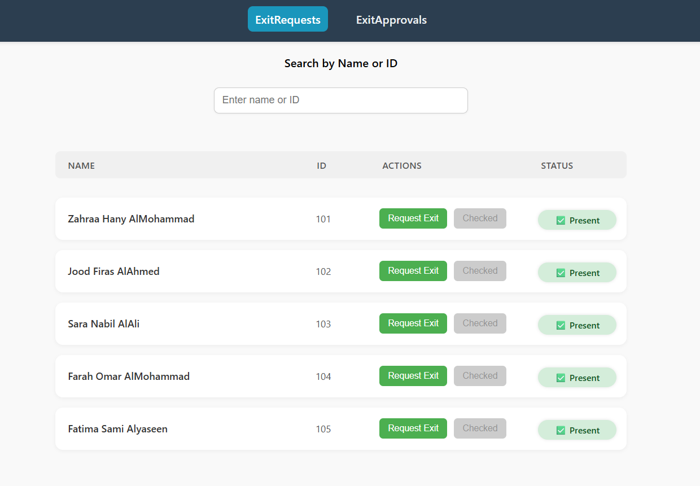

# School Exit Permission Management System

A web application developed as a practical case study for my Database Systems course. The project demonstrates the database development process, from requirements analysis and ERD design to relational schemas, SQL implementation, and web application integration.

The application accompanies my Database Systems course, where I explain the underlying concepts and demonstrate their practical application.

**Watch the video:** [Database Systems Course – Practical Case Study](https://www.youtube.com/playlist?list=PLNhh-eEPXpZ0)

## Application Preview



## Getting Started

### Prerequisites

- Node.js and npm
- MySQL Server

### 1. Configure the Backend

Create a `.env` file inside the `Backend` folder:

```env
PORT=
DB_HOST=
DB_USER=
DB_PASSWORD=
DB_NAME=
```

Fill in the values according to your local MySQL configuration.

### 2. Set Up the Database

Start the MySQL server and connect to it:

```bash
mysql -u root -p
```

Create a fresh database:

```sql
DROP DATABASE IF EXISTS db;
CREATE DATABASE db;
USE db;
```

**Warning:** This deletes the existing `db` database and its contents. Only use it with a local development database.

Copy and execute the SQL statements from:

`Backend/src/models/Tables.sql`

This creates the database tables and initializes the application data.

### 3. Start the Backend

From the `Backend` directory, run:

```bash
node src/server.js
```

The server should start on the configured port and establish a database connection.

### 4. Start the Frontend

Navigate to `Frontend/src` and run:

```bash
npm install
npm start
```

The web application should now be accessible through your local development server.
